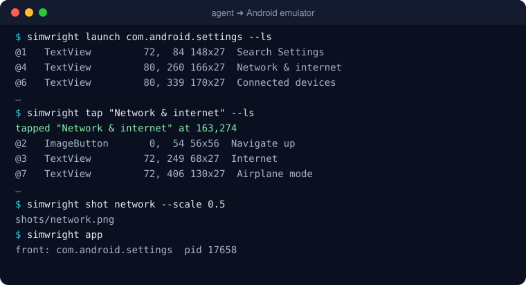
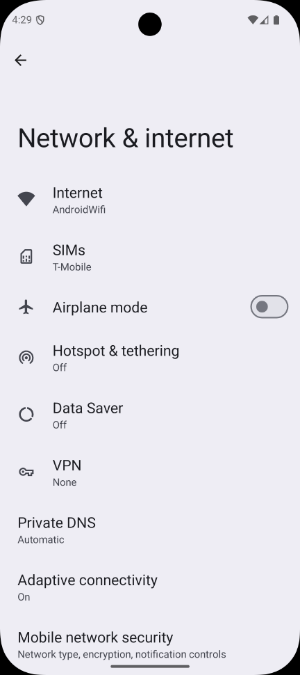

<div align="center">


**Let AI agents drive an iOS simulator or Android emulator from the shell**<br>
Read the screen, tap, type, swipe, screenshot, and read logs and crashes. No Appium, no WebDriverAgent, nothing installed on the device.

[](./LICENSE)
[](#requirements)
[](#how-it-works)
[](#how-it-works)
[](./package.json)

[Quick start](#quick-start) · [Commands](#commands) · [For AI agents](#for-ai-agents) · [Benchmark](BENCHMARK.md) · [Troubleshooting](#troubleshooting)

</div>

---

`simwright` is a small command-line tool for driving a mobile app in a simulator or emulator. Each command does one
thing and prints a few lines of plain text:

<p align="center">
  
  &nbsp;
  
</p>

That makes it a good fit for an AI coding agent (Claude Code, Cursor, Codex, opencode, …) that needs to **see and
use the app it's building**:
- **Small output.** A screen read is 1–2 KB of text, not 50–120 KB of XML. A screenshot is a file path, not
  200 KB of base64.
- **One call per step.** Add `--ls` to an action and its result comes back in the same call.
- **Fast.** Taps take about 0.1 s and screen reads 0.1–0.2 s on both platforms, with no session to set up first.

It's just as handy by hand, or in a shell script for screenshot sweeps and bug repros.

---

## Contents

- [What you get](#what-you-get): everything simwright does today
- [simwright vs Appium](#simwright-vs-appium): the measured comparison
- [Quick start](#quick-start): install, boot a device, first commands
- [🤖 Kickstart with your AI agent](#-kickstart-with-your-ai-agent): one prompt and your agent takes it from there
- [Requirements](#requirements)
- [How it works](#how-it-works)
- [Examples](#examples): tap by label, forms, waiting, scrolling, debugging, bursts, several devices
- [For AI agents](#for-ai-agents)
- [Commands](#commands) · [Options & config](#options-environment-variables-config-file)
- [Troubleshooting](#troubleshooting) · [FAQ](#faq) · [Roadmap](#roadmap)
- [Safety rules](#safety-rules) · [Contributing](#contributing) · [License](#license)

## What you get

| | What you get |
|---|---|
| 👀 | **Read the screen as text.** `ls` lists what's visible, one row per element: `@ref  type  x,y  w×h  label  = value`. It reads native screens, React Native screens and web content (Safari, in-app browsers, web views) |
| 👆 | **Tap by label.** Exact match first, then a prefix or substring that names exactly one label. An ambiguous match is an error, never a guess. Also by `@ref` from the last `ls`, or by `x y` coordinates |
| ⌨️ | **Type and fill.** `type` into the focused field, `fill` to clear a field and type, `key return\|escape\|delete\|tab\|…`, and `hidekb`, which never reports success while the keyboard is still up |
| 🧭 | **Navigate.** `swipe`, `scrollto <label>`, `back`, `open <deep link>`, `launch <app>` |
| ⏱️ | **Wait instead of sleep.** `wait "Welcome"`, `wait "Loading" --gone`. Actions already wait up to 3 s for their target |
| 📸 | **Screenshots.** `shot` saves a PNG and prints its path, with `--scale 0.5` for fewer image tokens. On Android emulators it also captures `FLAG_SECURE` screens |
| 🎞️ | **Burst capture.** `burst` saves a frame each time the screen changes, to catch spinners, toasts and transitions |
| 🪵 | **Logs.** `logs` shows the app's log since your last look. `--errors` and `--grep` narrow it, and on iOS Apple-framework chatter is filtered out |
| 💥 | **Crashes.** `crashes` reads iOS crash reports (exception, reason, top frames) and Android crashes, ANRs and **low-memory kills**, so "the app vanished" always comes with a reason |
| 🫆 | **Biometrics.** `bio match\|nomatch` simulates Face ID or a fingerprint |
| 🌍 | **Simulated conditions.** `location <lat> <lon>`, `appearance dark`, `textsize xxl` (Dynamic Type / font scale), `statusbar clean` (9:41 for screenshots), and iOS `push` notifications |
| 🧹 | **App state for repros.** `install` a build, `reset` an app to a fresh install, `uninstall`, and `permission grant\|revoke\|reset camera\|location\|photos\|…`, with the same names on both platforms |
| 🤖 | **Built for agents.** `--ls` on any action, `run` to batch steps, `--json`, and a [Claude Code skill](#for-ai-agents) you install with one command |
| 🧩 | **Nothing to install on the device**, no Appium server, no WebDriverAgent, no npm dependencies. The helpers start on first use |
| ⚠️ | **Honest failures.** A tap that's covered by a toast prints a warning, a stale `@ref` is an error rather than a wrong tap, and a system prompt over the app is reported as one |

## simwright vs Appium

Measured on the same devices (iPhone 14 simulator, Pixel 9a emulator), 10 runs per action, median time. Full method,
raw data and the earlier runs are in **[BENCHMARK.md](BENCHMARK.md)**.

| | **simwright** | Appium (raw HTTP) | Appium MCP |
|---|---|---|---|
| Setup before the first command | **0.04–0.13 s** | 7–17 s | 23–39 s |
| Read the screen (Android · iOS) | 131 ms · **202 ms** | **114 ms** · 915 ms | 1.87 s · 1.21 s |
| …and its size | **~1 KB of text** | 41–51 KB XML | 101–124 KB XML |
| Tap by label (Android · iOS) | 112 ms · **121 ms**, 1 call | **77 ms** · 1.51 s, 2 calls | 344 ms · 1.63 s, 2 calls |
| Fill a field (Android · iOS) | 792 ms · **782 ms** | 1.32 s · 2.33 s | **513 ms** · 2.51 s |
| Screenshot | **~130 ms, a ~70 B file path** | 130 ms–1.7 s, 78–221 KB base64 | 165–339 ms, 210–225 KB inline |
| Restart the app (Android · iOS) | **186 ms · 513 ms** | 753 ms · 4.26 s | 735 ms · 4.81 s |
| Failed operations (of 123 per platform) | **2 · 0**¹ | 10 · 10 | 12 · 10 |
| Biometrics | ✓ | ✓ | ✗ no tool |
| Logs and crash reports | ✓ | via separate APIs | ✗ |

¹ Not counting `hidekb` on the iOS 26 search keyboard, which has no key to dismiss it: every tool fails there,
and simwright is the only one that reports the failure instead of claiming success.

Raw Appium is slightly faster at reading and tapping on Android, because its helper app answers in-process. But it
returns about 50× more bytes per read and needs two calls per tap.

**Where Appium is still the better choice:** it runs on real iOS devices, plugs into existing WebDriver test
suites and CI grids, and supports many more platforms. simwright drives **iOS simulators** (not iPhones) and
Android emulators and devices, and it isn't a test framework.

## Quick start

```bash
# 1. install (Node 18+; zero dependencies)
npm install -g github:lakpriya1s/simwright

# 2. check the toolchain
simwright doctor

# 3. boot a device: an iOS simulator…
xcrun simctl boot "iPhone 16" && open -a Simulator
#    …or an Android emulator
$ANDROID_HOME/emulator/emulator -avd Pixel_9a &

# 4. drive it
simwright launch com.apple.Preferences --ls     # (Android: com.android.settings)
simwright tap "General" --ls
simwright shot general
```

To add the agent skill, which teaches Claude Code how to use simwright:

```bash
simwright skill --install      # → ~/.claude/skills/simwright/SKILL.md
```

<details>
<summary><strong>Other ways to install</strong></summary>

From a checkout:

```bash
git clone https://github.com/lakpriya1s/simwright.git
cd simwright && npm install -g .
```

As a tarball you can hand to someone (it includes both prebuilt helpers):

```bash
npm pack                                  # → simwright-0.1.0.tgz
npm install -g simwright-0.1.0.tgz        # on their machine
```

Without installing: `node bin/simwright.js --help`.

Uninstall: `npm uninstall -g simwright && rm -rf ~/.simwright`.
</details>

## 🤖 Kickstart with your AI agent

Paste this into your AI coding agent (Claude Code, Cursor, Codex, opencode, …) and let it set things up and
start using the app with you:

```text
Install simwright (https://github.com/lakpriya1s/simwright) so you can drive
my app in the iOS simulator / Android emulator:

1. Run `npm install -g github:lakpriya1s/simwright`, then `simwright doctor`,
   and fix anything it reports (boot a simulator or emulator if none is up).
2. Run `simwright skill --install` and read the skill it installs.
3. Find my app's bundle id / package name in this repo and write a
   simwright.config.json with it at the repo root.
4. Launch the app with `simwright launch --ls` and tell me what screen it's on.

Rules: never type real credentials, OTPs or card numbers. When the app needs a
sign-in, stop and let me do it, then continue from there.
```

## Requirements

| For | You need |
|---|---|
| Everything | **Node 18+** (`node -v`) |
| iOS | A Mac with **Xcode** (command-line tools selected) and at least one simulator runtime. Apple Silicon or Intel |
| Android | **Android SDK platform-tools** (`adb` on your `PATH`), and an emulator (AVD) or a USB-debugging device |

Tested with Xcode 26 / iOS 26 (iPhone 14 simulator) and Android 16 / API 36 (Pixel 9a emulator).

## How it works

simwright ships its own small helper for each platform. **Nothing is installed on the simulator or device.**

| | iOS simulator | Android emulator / device |
|---|---|---|
| Read the screen | `simwright-sim`, a macOS helper that reads the simulator's accessibility tree through Apple's simulator frameworks (CoreSimulator, AccessibilityPlatformTranslation). Web content is found by probing the screen | `simwright-server.jar`, an 8 KB helper pushed to `/data/local/tmp` and run with `app_process`. It keeps one UiAutomation connection open |
| Tap, type, swipe, keys | The same helper, as touch and keyboard events through SimulatorKit | The same helper, as input events through UiAutomation |
| Screenshots, `burst` | The simulator display's framebuffer, read in-process | Emulators: the emulator's gRPC API, which also gets past `FLAG_SECURE`. Devices: the helper |
| Logs, crashes | `log show` inside the simulator, and its `.ips` crash reports | `logcat` (by app uid), the crash buffer, and `dumpsys activity exit-info` |
| Deep links, launch, biometrics | `xcrun simctl` | `adb` and the emulator console |

Each helper starts on first use, keeps running in the background, and is replaced automatically when simwright is
upgraded. `simwright setup` starts it ahead of time, and `simwright teardown` stops it. The CLI talks to it over a
local socket, using JSON lines.

<details>
<summary><strong>iOS: private frameworks and Xcode versions</strong></summary>

The iOS helper uses Apple's private simulator frameworks, the same ones `idb` uses. They can change between Xcode
releases. `simwright doctor` checks they're present and shows which input path applies:

- **Xcode 26 and earlier** (CoreSimulator below 1155.4): touches and keys go through SimulatorKit's HID client
  ("indigo"). Tested.
- **Xcode 27** (CoreSimulator 1155.4 and later): touches and keys go as XPC messages to the simulator's
  `dtuhidd` service ("dtuhid"), the same way idb does it. **Implemented, not yet tested against Xcode 27.**
  Reading the screen and screenshots don't depend on it.

`SIMWRIGHT_IOS_HID=indigo|dtuhid` overrides the choice. It applies when the helper starts, so run
`simwright teardown` first.
</details>

<details>
<summary><strong>Android: the fallback path</strong></summary>

If the helper can't start (for example, another tool holds UiAutomation), simwright falls back to plain `adb` +
`uiautomator dump`. That works everywhere but takes about 2.5 s per screen read. `SIMWRIGHT_ANDROID_HELPER=0`
forces that path.
</details>

## Examples

### Look, then act

```bash
simwright ls
```

```
@1   Button           16, 285 358x54  General
@2   Button           16, 339 358x54  Accessibility
@3   TextField        33, 773 324x38  Search  = Search
```

Each row shows a **ref** (`@1`), the element type, its **x,y** position and **width×height** (iOS points /
Android dp, the units `tapxy` and `swipe` take), its **label**, and `= value` for fields that hold text. Unlabelled
buttons are listed too, as `(no label)`, so you can tap them by ref. The on-screen keyboard is a single row.

### Tap by label, not by coordinates

```bash
simwright tap "Open menu"              # exact label (or identifier on iOS)
# tapped "Open menu" at 30,62
simwright tap "Messages"               # no exact match → the one label starting with it
# tapped "Messages, 2 unread" at 342,62
simwright tap "Wi"                     # matches two different labels → refuses
# simwright: "Wi" is ambiguous — matches 2 labels: "Wi-Fi", "Wi-Fi hotspot"
simwright tap --exact "Messages"       # exact only
simwright tap @7                       # row @7 of the last ls
simwright tapxy 205 874                # when ls doesn't list it at all
```

- **A ref works only while its element is still where `ls` saw it.** If the screen changed, `tap @7` fails
  ("no longer on screen — run: simwright ls") rather than tapping something else.
- **If another element covers the tap point** (a toast, a dev-warning banner, a floating bar), `tap` prints a
  warning, because the tap probably landed on the cover instead.

### Fill a form and capture its validation errors

```bash
simwright fill "Email" not-an-email
simwright fill "Name" ""               # empty: just clears the field
simwright hidekb
simwright shot profile__validation
```

`fill` finds the field by its label (on iOS also its identifier), or else the first field at or below a matching
label. It clears the field and types. On Android it also presses Enter, because React Native fields only show
validation on blur.

`hidekb` tries, in order:
1. the keyboard's Done/Return key;
2. on iOS, the ✓ on a web form's Previous/Next bar;
3. a tap on plain text above the keyboard.

It checks after each. If the keyboard is still up, it **exits 2** rather than reporting success.

### Wait instead of sleeping, and scroll

```bash
simwright wait "Welcome"                  # until it's on screen (default up to 10 s; --wait 30)
simwright wait "Loading" --gone           # until it's gone
simwright scrollto "Privacy & Security"   # swipe until fully on screen; fails at the end of the list
simwright scrollto "General" --up
simwright swipe 200 700 200 250           # scroll down (finger moves up); optional 5th arg: ms
simwright back                            # Android: system Back · iOS: the navigation bar's back button
```

### Debug: logs, crashes, "where did my app go?"

```bash
simwright tap "Pay"                       # something goes wrong…
simwright logs --errors                   # the app's errors since the last `logs`
# 15:41:06.700 E [com.example:api] POST /payments failed: 422 amount_too_small
simwright logs --grep payment             # everything it logged that matches
simwright app --app com.example           # is it still running?
# front: com.android.launcher3  pid 1205
# com.example: not running — if it was, check: simwright crashes
simwright crashes
# com.example (pid 14001) exited at 14:56:06.724 while in the background: LOW_MEMORY — killed by the system to free memory, not a crash
```

**Each `logs` call starts where the previous one ended**, so a loop of *act → `logs`* only ever shows what's new.
`--since 5m` sets a fixed window instead.

**What's in the log:**
- **iOS:** what the app's own code logged, plus errors and faults from anything in its process. The simulator's
  own noise (low-level networking, the keyboard) is hidden. `--all` shows everything, Apple frameworks included.
  A read takes about 1–2 s.
- **Android:** everything logcat has for the app's uid, so restarts are covered. A read takes about 0.1 s.

**What `crashes` reports:**
- **iOS:** each crash report as exception, reason (such as an uncaught `NSException`), the crashed thread's top
  frames, and the path to the full `.ips` report.
- **Android:** Java crashes, native tombstones, ANRs, and exits that leave no crash report, low-memory kills above
  all.

**React Native:** in development builds, JS `console.*` output and uncaught JS errors are in `logs` on both
platforms:
- **iOS:** as `[com.facebook.react.log:javascript]` lines.
- **Android:** as `ReactNativeJS` lines.

A red box is also on screen, so `ls` reads its message and call stack.

**Swift:** `print()` writes to stdout, not to the log. Use `os.Logger` or `NSLog` for messages `logs` should see.

### Catch a spinner, toast, or transition (`burst`)

Start the burst **in the background**, then trigger the action:

```bash
simwright burst ./frames 5 &              # 5 s: a frame each time the screen changes
simwright swipe 200 250 200 700           # pull to refresh
wait
# 61 frames, 23 distinct, in ./frames
```

### Start from a clean state: install, reset, permissions

```bash
simwright install build/MyApp.app          # iOS: a simulator build · Android: an .apk (keeps the app's data)
# installed com.example.myapp
simwright reset com.example.myapp          # as if freshly installed: data and permissions cleared
simwright permission grant location com.example.myapp    # no prompt
simwright permission revoke photos com.example.myapp     # test the "denied" path
simwright permission reset camera com.example.myapp      # it asks again on next use
simwright uninstall com.example.myapp
```

- **`reset`:**
  - **iOS:** simwright copies the app's own bundle aside, uninstalls it and installs the copy, so documents,
    caches, app groups and permissions all go. The **keychain survives**, just as it does on a real iPhone, so
    an app that keeps its sign-in token there may still be signed in.
  - **Android:** `pm clear`.
- **Permission names** are the same on both platforms: `camera`, `microphone`, `location`, `location-always`,
  `photos`, `contacts`, `calendar`, `notifications`, `motion`, `all`.
  - Android also takes any `android.permission.*`, and acts only on permissions the app declares. A `reset` also
    clears "don't ask again".
  - The iOS simulator can't set `camera` or `notifications`; simwright says so.
- **These commands never guess the app from the screen.** `uninstall`, `reset` and `permission` take the app id
  as an argument, or from `--app` / `simwright.config.json`.

### Simulated conditions: location, dark mode, text size, push

```bash
simwright location 51.5072 -0.1276        # GPS (Android: emulators) · `location clear` on iOS
simwright appearance dark                 # or light; no argument prints the current one
simwright textsize ax2                    # Dynamic Type / font scale: xs s m l xl xxl xxxl ax1…ax5
simwright statusbar clean                 # 9:41, full battery and Wi-Fi, for screenshots · `statusbar live`
simwright push com.example.myapp "Your order has shipped"          # iOS: an alert
simwright push com.example.myapp '{"aps":{"alert":"Hi"},"orderId":7}'   # or any payload / a .json file
```

- **`textsize`** uses the iOS Dynamic Type sizes. On Android each size maps to the nearest font scale, from 0.8
  to 2.0, the default being `l` / `large` on both.
- **`statusbar clean`** uses iOS status-bar overrides, and Android's System UI demo mode.
- **`push`** delivers a remote notification the way APNs would. The app needs notification permission, as on a
  device.
  - A payload without `"aps"` is sent as a silent (background) push carrying that data.
  - **Android pushes can't be simulated locally.** They come through Firebase (FCM), so send them from your
    backend or the Firebase console.

### Biometrics

```bash
simwright bio match       # iOS: Face ID success · Android: enrolled finger 1
simwright bio nomatch     # iOS: Face ID failure · Android: unknown finger
```

On Android, enrol a fingerprint once first: Settings → Security → Fingerprint, using a screen-lock PIN, and touch
with `simwright bio match` when it asks.

### Same screen on several devices

```bash
simwright devices
# ios      42E41FA7-…  iPhone 14
# ios      F9213EDC-…  iPhone 16 Pro
# android  emulator-5554

for d in 42E41FA7-EA40-45C1-8C6E-13A70BAF1FD6 F9213EDC-180D-412B-B24C-2FD69A37D3AC; do
  simwright -d $d open myapp://home
  simwright -d $d wait "Home"
  simwright -d $d shot -o shots/$d home
done
```

Passing **both** `-p` and `-d` (or exporting `SIMWRIGHT_PLATFORM` and `SIMWRIGHT_DEVICE`) makes every command about
0.2 s faster, because simwright then skips listing devices.

### A repeatable screenshot sweep

```bash
#!/bin/sh
set -e
simwright launch
for route in home search messages profile settings; do
  simwright open "myapp://$route" --ls > /dev/null
  simwright shot "$route"
  simwright swipe 200 700 200 250
  simwright shot "${route}__scrolled"
done
```

### Android screenshots of secure screens

Apps that set `FLAG_SECURE` (common in banking and payment apps) make normal Android screenshots come out black. On
emulators, `simwright shot` takes the frame from the emulator itself, which gets past that. `--plain` takes a normal
on-device screenshot, for example to check that a screen *is* secure.

## For AI agents

Install the skill so your agent knows the loop, the shortcuts and the rules:

```bash
simwright skill --install       # → ~/.claude/skills/simwright/SKILL.md   (simwright skill prints it)
```

An agent spends seconds per turn, so **turns** matter more than milliseconds. simwright is built to save them:

- **`--ls` on any action** prints the screen once it has settled, so acting and looking take one turn instead of two:

  ```bash
  simwright tap @3 --ls
  simwright fill "Email" a@b.co --ls
  ```

- **`wait`** instead of guessing `sleep`s. After an action that loads data, `--ls` can return a loading skeleton,
  so wait for the text you expect.
- **`run`** batches steps you already know into one call and one process. It prints each step as `$ <step>`, stops
  at the first failure, and names it:

  ```bash
  simwright run 'tap General; wait About; tap About --ls'
  simwright run - < steps.txt          # one step per line, # for comments
  ```

- **`logs` / `crashes`** after a step that misbehaved. Each `logs` shows only what's new since the last one.
- **`ls --json`** for structured output: `{screen, elements: [{ref, label, type, x, y, w, h, value}]}`.
- **`shot --scale 0.5`** costs a quarter of the image tokens when the agent needs to *see* the screen (layout,
  colours, images). Usually `ls` is enough and the PNG is never opened.
- **Hints when the screen isn't what it seems.** When a passcode or permission prompt covers the app, `ls`
  prints a hint rather than an empty list.

Why a CLI and not an MCP server? Any agent with a shell can use it with no configuration, and its output is
already as small as it gets. An MCP server is on the [roadmap](#roadmap) for clients without a shell.

## Commands

| Command | What it does |
|---|---|
| **Look** | |
| `simwright ls [--all] [--json]` | Visible elements with a label, plus unlabelled buttons, each with an `@ref`. `--all` includes everything. `--json` prints `{screen, elements}`. While the screen is still loading (nothing labelled yet), waits up to `--wait` |
| `simwright wait <label\|@ref> [--gone]` | Until it's on screen (with `--gone`, until it isn't). Default up to 10 s, or `--wait`. Exits 2 on timeout |
| `simwright scrollto <label> [--up]` | Swipes until the element is fully on screen. Fails at the end of the list, or after 15 swipes |
| `simwright shot <name> [--plain] [--scale f]` | Saves `<out>/<name>.png` and prints its path |
| `simwright burst <dir> <seconds>` | A frame each time the screen changes. Only distinct frames are kept |
| **Act** (add `--ls` to print the settled screen afterwards) | |
| `simwright tap <label\|@ref> [--exact]` | `@ref` from the last `ls`, or a label: exact, else a prefix/contains match that names a single label (ambiguous → exit 2). Prints what it tapped |
| `simwright tapxy <x> <y>` | Taps a point (iOS points / Android dp) |
| `simwright type <text>` | Types into the focused field. On iOS, characters the keyboard can't type are pasted |
| `simwright key <name> …` | `return`, `escape`, `delete`, `tab`, `space`. Android also `back`, `home`, any `KEYCODE_*`. iOS also `selectall`, `paste` |
| `simwright fill <label\|@ref> <text> [--exact]` | Focuses the field, clears it, types. Empty text just clears |
| `simwright hidekb` | Dismisses the keyboard, checking after each method. Exits 2 if it's still up |
| `simwright swipe <x1> <y1> <x2> <y2> [ms]` | Default 150 ms on iOS, 300 ms on Android |
| `simwright back` | Android system Back · iOS: the navigation bar's back button, else a top-left "Back" button |
| `simwright open <url>` | Opens a deep link |
| `simwright launch [app]` | (Re)starts the app |
| `simwright bio match\|nomatch` | Face ID (iOS) or fingerprint (Android) |
| **Debug** (`[app]` defaults to `--app` / config, else the app in front) | |
| `simwright logs [app] [--errors] [--grep re] [--since 5m] [--lines n] [--all]` | The app's log since the last `logs` (the first call covers the last minute). At most 80 lines, newest kept |
| `simwright crashes [app] [--since 1h]` | Crashes, ANRs and low-memory kills since the last `crashes` (the first call covers the last hour) |
| `simwright app [app]` | The app in front and its pid, and whether `[app]` is running |
| **App state** (`<app>` from the argument or `--app` / config, never the app in front) | |
| `simwright install <path> [--grant]` | iOS: a simulator `.app`. Android: an `.apk`, replacing an installed copy and keeping its data (`--grant`: all runtime permissions). Prints the app id |
| `simwright uninstall <app>` | Removes the app |
| `simwright reset <app>` | As if freshly installed: data and permissions cleared. iOS: the keychain survives |
| `simwright permission grant\|revoke\|reset <name> [app]` | `camera`, `microphone`, `location`, `location-always`, `photos`, `contacts`, `calendar`, `notifications`, `motion`, `all`, … Android also takes `android.permission.*` |
| **Conditions** | |
| `simwright location <lat> <lon>` · `location clear` | Simulated GPS. Android: emulators only, and the emulator keeps its last fix (no `clear`) |
| `simwright appearance [dark\|light]` | Dark mode. Without an argument, prints the current mode |
| `simwright textsize [size]` | Dynamic Type (iOS) / font scale (Android): `xs s m l xl xxl xxxl ax1…ax5`, or iOS names such as `accessibility-large`. Without an argument, prints the current size |
| `simwright statusbar clean\|live` | A screenshot-clean status bar (9:41, full battery and Wi-Fi), or back to live values |
| `simwright push <app> <payload>` | iOS: a remote notification. The payload can be a `.json` file, inline JSON, or plain text for an alert |
| **Batch, setup & info** | |
| `simwright run '<cmd>; <cmd> …'` | Several commands in one process. `run -` reads them from stdin. Stops at the first failure and names it |
| `simwright skill [--install]` | Prints the AI-agent guide, or installs it as a Claude Code skill |
| `simwright devices` | Booted simulators and adb devices |
| `simwright doctor` | Checks Node, Xcode and the simulator frameworks, adb, and booted devices |
| `simwright setup` | Starts the helper ahead of time. Android: also `adb reverse tcp:8081` for Metro |
| `simwright teardown` | Stops the helper. Android: also removes `adb reverse` rules |

**`--ls`** works on `tap`, `tapxy`, `fill`, `type`, `key`, `hidekb`, `swipe`, `back`, `open`, `launch`, `bio` and
`scrollto`. After the action it waits for the screen to change (up to 1.5 s, or 6 s for `launch`/`open`), then for
it to stop changing, then prints it like `ls`.

**Exit codes:** `0` means OK. `2` means a usage problem: bad arguments, element not found, no device, or the
helper can't start. `1` means anything else failed. A script can `set -e` and stop at the first missing element.

## Options, environment variables, config file

| Option | Meaning |
|---|---|
| `-p, --platform ios\|android` | Default: whichever has a booted device. Required when both do |
| `-d, --device <udid\|serial>` | Default: the only booted one |
| `-o, --out <dir>` | Screenshot folder (default `shots`) |
| `--wait <seconds>` | How long `tap`, `fill` and `back` look for their target (default `3`). An ambiguous match fails at once |
| `--app <id>` | App id for `launch`, `open`, `logs`, `crashes`, `app`, `uninstall`, `reset` and `permission` |
| `-h, --help` · `-v, --version` | |

| Environment variable | Meaning |
|---|---|
| `SIMWRIGHT_PLATFORM`, `SIMWRIGHT_DEVICE`, `SIMWRIGHT_OUT`, `SIMWRIGHT_WAIT` | Defaults for `-p`, `-d`, `-o`, `--wait` |
| `SIMWRIGHT_SCALE` | Override Android's px-per-dp (normally read from `wm density`) |
| `SIMWRIGHT_ANDROID_HELPER=0` | Plain `adb` + `uiautomator dump` instead of the helper (slower) |
| `SIMWRIGHT_EMULATOR_GRPC=0` | Don't take emulator frames over gRPC: use the emulator console |
| `SIMWRIGHT_IOS_HID=indigo\|dtuhid` | Force the iOS input path. Takes effect when the helper starts |
| `SIMWRIGHT_HOME` | Where sockets, logs and state live (default `~/.simwright`) |

**Config file.** simwright uses the nearest `simwright.config.json`, walking up from the current folder. Put it at
the root of your app's repo:

```json
{
  "out": "shots",
  "ios": { "app": "com.example.myapp" },
  "android": { "app": "com.example.myapp" }
}
```

Precedence: command-line option, then environment variable, then config file, then built-in default.

<details>
<summary><strong>Files simwright writes</strong></summary>

| Path | What |
|---|---|
| `~/.simwright/sim-<udid prefix>.sock`, `.log` | The iOS helper's socket and log |
| `~/.simwright/helpers.json` | Which local port reaches each Android device's helper |
| `~/.simwright/refs/<device>.json` | What `@1`…`@N` meant in the last `ls` on that device |
| `~/.simwright/marks/<device>.json` | Where the last `logs` / `crashes` stopped |
| `/data/local/tmp/simwright-server.jar` (device) | The Android helper |
| `<out>/<name>.png` | Your screenshots |
</details>

## Troubleshooting

| Symptom | Fix |
|---|---|
| iOS: `SimulatorKit not found …` / `… has no Indigo HID builders` | Run `simwright doctor`. Point `xcode-select` at a full Xcode: `sudo xcode-select -s /Applications/Xcode.app` |
| iOS: `input unavailable (dtuhid): dtuhidd did not answer` | The simulator is still booting, or its input service is restarting. Retry in a few seconds |
| iOS: an element you can see is missing from `ls` | Some containers hide their children from accessibility. simwright probes for them, but `tapxy` is the fallback |
| `only the status bar is readable — a system prompt … may be covering the app` | A passcode, permission or alert prompt drawn by iOS. `simwright shot` to see it |
| `both iOS and Android devices are up — pass -p ios\|android` | Add `-p`, or `export SIMWRIGHT_PLATFORM=…` |
| `not found: <label>` | Run `simwright ls` and copy the label. If the screen is slow to load, raise `--wait` |
| `"<label>" is ambiguous — matches N labels` | Use more of the label, a `@ref`, or `--exact` |
| `keyboard is still up` (iOS) | Search keyboards have no Done key. Tap the screen's Cancel/close control |
| Android `ls` fails right after boot | Wait until `adb shell getprop sys.boot_completed` prints `1` |
| Android `ls` fails after Appium was used | Appium still holds UiAutomation: `adb shell am force-stop io.appium.uiautomator2.server` |
| Appium / `uiautomator` fail after simwright was used | simwright's helper holds UiAutomation: `simwright -p android teardown` |
| `Android helper did not start — falling back to uiautomator dump` | Something else holds UiAutomation (see above). simwright keeps working, just slower |
| Android keyboard never appears | Set `hw.keyboard = no` in the AVD's `config.ini`, then cold-boot the emulator |
| Android screenshot is black | That screen is `FLAG_SECURE`: use `shot` without `--plain` on an emulator. System PIN and biometric sheets stay black in every mode |
| App sits on the splash screen (Android, React Native) | Metro isn't reachable: `simwright setup` (adds `adb reverse tcp:8081`), make sure Metro runs, then `simwright launch` |
| `launch` says `no launchable activity` | The app isn't installed or the id is wrong: `adb shell pm list packages`, or `xcrun simctl listapps booted` |
| `type` fails on non-ASCII text (Android) | Type those characters on the device. On iOS, simwright pastes what it can't type |

## FAQ

<details>
<summary><strong>Is this a test framework?</strong></summary>

No. It has no assertions, spec files or reporters. It's for looking at and using an app: by an agent while it
builds a feature, by you while you debug, or in a script that sweeps screenshots. Checks that should run on every
build belong in your app's own test suite (XCTest, Espresso, Detox, Maestro, …).
</details>

<details>
<summary><strong>Does it work on a real iPhone?</strong></summary>

No: on iOS it drives **simulators** only, through Apple's simulator frameworks. On Android it works with emulators
and with USB-debugging devices. (On a device, screenshots go through the device, so `FLAG_SECURE` screens are
black.)
</details>

<details>
<summary><strong>Does it install anything on my device or in my app?</strong></summary>

Nothing on the iOS simulator. On Android it copies an 8 KB helper to `/data/local/tmp` and runs it with
`app_process`, the way `scrcpy` does. No APK is installed, no app is modified, and there's no SDK to add to your app.
`simwright teardown` stops the helper.
</details>

<details>
<summary><strong>Does it work with React Native, Flutter, SwiftUI, Compose, web views?</strong></summary>

It reads the platform accessibility tree, so anything that exposes accessibility labels works. That includes React
Native (it was built while driving RN apps), SwiftUI, UIKit, Compose and Views. It also reads web content in
Safari, in-app browsers and web views. Flutter isn't tested yet: it exposes elements through its semantics tree,
so it should work wherever that is enabled. Elements without a label show as `(no label)` and can be tapped by `@ref`.
</details>

<details>
<summary><strong>Linux or Windows?</strong></summary>

iOS needs a Mac. The Android side is plain Node + `adb` and should work anywhere they do. It's developed and tested
on macOS.
</details>

<details>
<summary><strong>Will an Xcode update break it?</strong></summary>

It can. The iOS helper uses private simulator frameworks, like `idb` does. `simwright doctor` tells you if something
it needs has moved. Reading the screen and screenshots have held steady. Input changed in Xcode 27, and simwright
already has a path for that, though it isn't tested yet.
</details>

<details>
<summary><strong>Can my agent sign in to my app with it?</strong></summary>

It can type, but it **shouldn't type real credentials**. Have a person sign in (and enter OTPs), then let the agent
continue. The skill tells agents exactly that. See [Safety rules](#safety-rules).
</details>

## Roadmap

- A warning after any action when the app has died (instead of the agent noticing a home screen)
- Long press and multi-finger gestures
- Verified Xcode 27 input
- An MCP server for agents without a shell

Ideas and votes welcome in [Issues](https://github.com/lakpriya1s/simwright/issues).

## Safety rules

- **Never script a sign-in with real credentials,** whether from a shell script or an AI agent. A person signs in
  and enters OTPs, then simwright takes over.
- **Never `burst` a sign-in or passcode screen.** The frames capture what's typed.
- **Against a live backend, every tap is real.** Use the smallest amounts, then undo what you created.
- **Logs can contain tokens and personal data.** Quote only the lines that matter, and don't commit screenshots of
  real customer data.

## Contributing

```bash
git clone https://github.com/lakpriya1s/simwright.git
cd simwright
npm test                          # unit tests, no device needed
native/ios/build.sh               # rebuild the iOS helper (needs Xcode)
native/android/build.sh           # rebuild the Android helper (needs the Android SDK + a JDK)
node bin/simwright.js --help      # run from source
```

```
bin/simwright.js        CLI: arguments, device selection, commands
lib/ios.js              iOS driver: helper client, simctl, logs, crash reports
lib/android.js          Android driver: helper client, adb fallback, logcat, exits
lib/screen.js           ls rows, @refs, wait, scrollto, settle (platform-neutral)
lib/logs.js             logs/crashes windows and formatting
lib/helper.js           the JSON-lines socket protocol both helpers speak
lib/emulator.js         Android emulator gRPC frames, no dependencies
lib/png.js · lib/util.js
lib/assets/             built helpers (simwright-sim, simwright-server.jar)
native/ios/             iOS helper source (Objective-C)
native/android/         Android helper source (Java)
skills/simwright/       the AI-agent guide
```

Notes for contributors:
- **Zero dependencies, on purpose.** Use only Node built-ins. The helpers use only what ships with macOS/Xcode
  and Android.
- **Helpers are versioned by content hash.** After you rebuild one, the next command replaces the running copy.
  Commit the rebuilt file in `lib/assets/`.
- **A new command needs:**
  - a method on both `Ios` and `Android`, or, if it only reads the screen, code in `lib/screen.js`;
  - a `case` in `bin/simwright.js`;
  - a row in this README;
  - a line in `skills/simwright/SKILL.md` if agents should use it.

Issues and PRs welcome. If simwright saved your agent some tokens, a ⭐ helps others find it.

## License

[AGPL-3.0](./LICENSE) © Lakpriya Senevirathna. You're free to use, modify and self-host it. If you run a
modified version as a service for others, you must publish your changes under the same license.

---

simwright is an independent open-source project, **not affiliated with, endorsed by or sponsored by Apple Inc.,
Google LLC or the Appium project.** iOS, iPhone, Xcode and Face ID are trademarks of Apple Inc. Android is a
trademark of Google LLC.

<div align="center">
<sub>Text in · taps out · simwright</sub>
</div>
